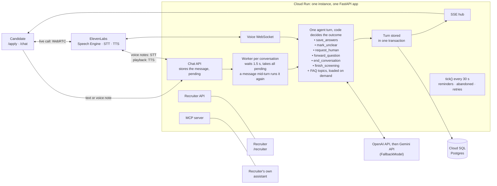

# candidate-screening-agent

AI screening agent for delivery-driver applicants (fictional client: Grupo Sazón, Spain and Mexico). Candidates are screened over chat, voice notes or a live call. Recruiters work from a recruiter tool, or ask their own assistant over MCP.

Read first: [Try the demo](#try-the-demo), [Architecture](#architecture), [Key design decisions](#key-design-decisions) and [Potential improvements](#potential-improvements), about 10 minutes. [Setup](#setup) runs it locally; everything after it is reference.

- **Process design** (Phase 1): [`docs/process-design.md`](docs/process-design.md)
- **Production design**, design only (ATS integration, WhatsApp, scaling to 10K candidates a week, monitoring, retention, the full list of improvements): [`docs/production-design.md`](docs/production-design.md)
- **Agent and contributor rules:** [`AGENTS.md`](AGENTS.md)

## Try the demo

The deployed app's URL, the access code, the recruiter password and the MCP URL come with the submission. None of them is in this repo.

1. **Apply** at `/apply`, with the access code and made-up details. The confirmation shows a "Continue in the chat" button, and a QR code to continue on a phone.
2. **Screen:** chat, send a voice note (the mic next to Send) or call (the call button at the top of the chat).
3. **Review:** open the candidate in the recruiter tool at `/recruiter`, signed in with any name and the password.

To ask your own assistant instead, add the MCP URL as a connector ([MCP server for recruiters](#mcp-server-for-recruiters)).

## Architecture



**One message, end to end** ([`service.py`](backend/src/screening/service.py)):
1. **Apply.** `/apply` (in production, the ATS) creates the candidate and sends the first message: a template, stored as a turn.
2. **Store first.** The candidate's message is stored as pending and echoed. From here nothing is lost.
3. **Debounce.** The conversation's one worker waits 1.5 s (`CHAT_DEBOUNCE_SECONDS`), then answers everything pending in one turn. A message that arrives mid-turn makes it run again with that message ([decision 5](#key-design-decisions)).
4. **One turn.** The agent reads the stored history, a context block with the saved state, and the new messages. Its tools check what we own (service areas, dates) and save into a copy of the state.
5. **Code decides.** `finish_screening` computes the outcome from the saved state ([`domain.py`](backend/src/screening/domain.py)); the model only words it.
6. **Store, then publish.** The turn (model messages, state, replies, prompt version, models, usage) commits in one transaction, then the replies go out over SSE through the channel adapter ([`channels.py`](backend/src/screening/channels.py)). A failed turn stores its error and sends the "give me a moment" template once; the messages stay pending ([Timeouts, retries and limits](#timeouts-retries-and-limits)).
7. **Summary.** When the screening ends, a second agent writes the recruiter's caveats and notes about the candidate. The key data (every answer, the outcome and its reasons) are built by code from the saved state.

**Around it, in the same app:**
- **The recruiter tool** (`/recruiter`): tabs, key data built by code, the AI summary, and decisions sent to the candidate as templates. [Recruiter tool](#recruiter-tool)
- **Timed work:** `tick()` runs every 30 s under a Postgres advisory lock. It sends reminders, marks silent chats abandoned, retries failed turns and writes lost summaries. [Timed work](#timed-work-reminders-abandoned-chats-retries)
- **Voice notes:** the mic button posts a note, ElevenLabs' batch speech-to-text transcribes it, and the transcript takes the text chat's path from step 2. Each of our messages can be played, as speech made on demand from its stored text. [Voice notes](#voice-notes)
- **Live calls:** ElevenLabs Speech Engine handles speech and turn-taking, and calls our WebSocket once per candidate turn. The same agent, tools and state answer, under the conversation's lock. [Live voice calls](#live-voice-calls)
- **The MCP server:** mounted at `/mcp/<token>` in the same FastAPI app, with three read-only tools over the recruiter API. [MCP server for recruiters](#mcp-server-for-recruiters)
- **Deployment:** one Cloud Run service (the API and the built frontend) on a single instance, with Cloud SQL (Postgres 18) and Secret Manager. [Deployment](#deployment-gcp), and past one instance, the [production design](docs/production-design.md#scaling-to-10k-candidates-a-week).

**Code map** (`backend/src/screening/`): `domain.py` (rules and lookups, pure) · `agent.py` (the two agents, the tools, the FAQ topics, the context block) · `service.py` (ingest, workers, `tick` and decisions, at the database edge) · `channels.py` (the channel Protocol and the SSE hub) · `api.py`, `voice.py`, `mcp_server.py` (the HTTP edges) · `prompts/`. The client's data (locations, FAQ topics, templates, timings) is in `backend/config/grupo_sazon.yaml`.

## Key design decisions

**1. One agent with tools, not a scripted state machine.**
- *Problem:* candidates answer out of order, give three answers in one message, ask about pay halfway through and switch language. A state machine needs a branch for each, and the first build (extractor → code → responder) sounded robotic.
- *Choice:* one PydanticAI agent follows the process from its prompt, and calls six tools of ours, plus the one that loads a topic. The evals enforce the process rules: knockouts first, at most two tries, nothing asked twice, short messages with the question last. The tools, all on the turn's copy of the state (decision 4):
  - `save_answers(answers)`: saves what the candidate said, several answers at once, corrections included. Code checks places and postal codes against the service areas and resolves dates; what it can't save comes back with the reason and the valid options.
  - `mark_unclear(field, note)`: gives up on a field after two tries. The recruiter sees it as unclear, with the note.
  - `request_human(reason)`: the candidate asks for a person. A recruiter reviews the screening and contacts them.
  - `forward_question(question)`: a question the job's facts don't answer, passed to the recruiter as an open question.
  - `end_conversation(reason)`: not interested (or STOP), not the person who applied, or abuse after one warning. Abuse goes to a person for review; the other two withdraw the application.
  - `finish_screening()`: the outcome, computed by code from the saved state (decision 2). It refuses while answers are missing.
  - `load_capability(id)`: PydanticAI's own; loads one topic of the job's facts (below).
- *Rejected:* a form engine, or a state machine with a model call per step.
- *Limit:* the behaviour is measured, not guaranteed. Every prompt change runs the simulated set (about $1 a run on terra, without the judge), and each new failure becomes an eval case before the fix.
- **The job's facts work the same way.**
  - *Choice:* the job's facts (pay, shifts, vehicle, documents, how hiring works, where we hire) are five topics, plus one rendered from the locations in the vacancy's country. Each is a deferred capability that the agent loads when a question needs it (`load_capability`), so the prompt carries the list of topics, not the answers.
  - *Rejected:* retrieval over embeddings, for a few kilobytes of text that a recruiter edits in one YAML file.
  - *Limit:* a question on a topic not yet loaded costs one more request, and a call loads the topic again for each question ([Live voice calls, Limits](#limits)).

**2. The model extracts, code decides: "unknown" is never "no".**
- *Problem:* a wrongful knockout is the worst error. "I have a license from Venezuela, not sure it's valid here" must not become a "no".
- *Choice:*
  - The agent passes `save_answers` only what the candidate said. The license is yes, no or not saved; after two tries, `mark_unclear` sends it to a person.
  - The area works the same way. A place is saved as given, with or without its city, and a code that can't exist (four digits, or a Spanish province outside 01–52) is asked again. The instructions hold an area knockout until the candidate has confirmed the code, and if they also named a place of ours, they're asked which is right.
  - Code checks postal codes and places against the service areas (an unknown place is "not saved", never "outside") and resolves dates.
  - `finish_screening` computes the outcome from the saved state, and refuses while answers are missing.
  - The foreign-license case gates every model: 5 runs, and it must end unclear every time.
- *Rejected:* asking the model for the outcome or a score.
- *Limit:* code can't tell whether the candidate really said what the model saved. gpt-6-luna and Claude Haiku 5.5 (at low effort) saved answers nobody gave, which ruled them out ([model choice](#why-gpt-56-terra-with-gemini-38-flash-as-the-fallback)). The evals check every saved answer against what the candidate had said by then (`grounded`); production has no such check.

**3. The screening state lives in the database, not in the message history.**
- *Problem:* the outcome needs checked facts, not a model's reading of a long chat. And some facts change outside the chat: a recruiter's decision, a reminder we sent.
- *Choice:*
  - `candidates.state` (a Pydantic model in JSONB) is the record, and the tools read and write it.
  - Each turn starts with a context block of values: saved, unclear, still to ask, review flags, the outcome, and the recruiter's decision from its own column.
  - The history is kept too, append-only, for the conversation's tone and the provider's prompt cache (97% of input read from it on terra). It isn't the record.
- *Rejected:* the history as the only memory, or a model-written running summary.
- *Limit:* the history is cut to the last 50 messages, by whole turns (about 12 turns). That's enough for a screening (about 9 turns per completed screening in the evals), not for a months-long relationship.

**4. A turn is stored whole, or not at all.**
- *Problem:* a deploy, a crash or a timeout can stop a turn halfway.
- *Choice:*
  - Tools change only an in-memory copy of the state. The turn's model messages, state and replies commit in one transaction after the run.
  - A turn that fails stores only its error, and the "give me a moment" template once; one stopped by a deploy or a crash stores nothing. Either way the candidate's messages stay pending, and their next message, a restart or the timed retry runs it again.
  - A voice turn cut off by the candidate is discarded whole, for the same reason.
- *Rejected:* durable execution per step (PydanticAI supports Temporal, DBOS and Prefect), a second system to run for turns of about 3 s whose tools have no outside effects.
- *Limit:* a re-run repeats the model calls and may word the reply differently. It stays safe only while tools touch nothing outside the database transaction. Booking a slot or calling the ATS would need an outbox ([ATS integration](docs/production-design.md#auth-retries-and-field-mapping)).

**5. The debounce: one worker per conversation, and a turn run again for a new message.**
- *Problem:* a candidate's messages can arrive faster than we answer, two sent in quick succession or one typed while a turn is still running. A turn per message would mean replies that overlap and answer half of what was said.
- *Choice:*
  - One worker per conversation waits 1.5 s from the first message (`CHAT_DEBOUNCE_SECONDS`), then runs one turn on everything pending.
  - A message that arrives while the turn runs marks it superseded. The run finishes but isn't stored or sent, and the turn runs again after the wait with every pending message, at most twice in a row (a stored turn resets the count). Throwing a run away is safe because tools change only the state in memory and a turn is stored in one transaction (decision 4).
  - The thrown-away run's usage is added to the next stored turn, so our cost per screening stays exact. Its span keeps the usage too, marked `superseded=true`.
  - A call cuts its turn instead, because the reply is already being spoken. In the chat nothing is shown until the turn is stored, so there's nothing to cut.
  - "hola" · "soy Marta" · "vivo en el 28015" ("hi" · "I'm Marta" · "I live in 28015"), sent about 2 s apart on prod, got one reply 8.5 s after the first message and 4.3 s after the last, with two runs thrown away, instead of a reply to "hola" and another to the rest.
  - Two turns of the same conversation never overlap: the worker and a call take the same lock.
- *Rejected:* a turn per message; a long window, which slows every reply; a window that restarts with each message, which only helps when it's long, since a second message typed on a phone comes seconds after the first; cancelling the run, which loses the usage of the request in flight.
- *Limit:*
  - A thrown-away run is paid in full.
  - A long turn (a topic load, a save and a reply, about 4 s) can delay the reply by up to about 2 s.
  - The worker and its lock live in the process, which is one reason the service runs as a single instance.

**6. Templates for everything sent outside a turn.**
- *Problem:* WhatsApp takes free text only within 24 hours of the candidate's last message. And the "give me a moment" notice can't come from a model that's failing.
- *Choice:* the first message, the reminders, the recruiter's decision and the failure notice are templates per locale in the client config. The first three are stored as turns, so the agent sees what we sent. Everything inside a turn is the agent's own words.
- *Rejected:* reminders and decisions written by the agent (free text outside the window), or templates for the screening itself (a form).
- *Limit:* a template only fills fixed slots (the name, the city, where the chat stopped). A decision can't answer the candidate's last question; the agent does once they write again.

**7. The model, chosen by evals.**
- *Problem:* in a chat, latency matters as much as quality. And a model that invents answers is out at any price.
- *Choice:* GPT-5.6 terra with reasoning off, and Gemini 3.8 Flash on another provider as the fallback. On the shipped prompt, every deterministic check is at 1.00 but `regional_terms` (0.98), with 2.6 s per turn at p50 and 3.9 s at p95; $0.023 per completed screening in the model round. [The runs](#why-gpt-56-terra-with-gemini-38-flash-as-the-fallback)
- *Rejected:*
  - gpt-6-luna: 19× cheaper, but it saved answers the candidate never gave.
  - Claude Haiku 5.5: failed the license gate.
  - Gemini on Vertex AI `eu`, for the demo ([why](#why-gpt-56-terra-with-gemini-38-flash-as-the-fallback)).
- *Limit:* the demo's data leaves the EU; real candidates need the Vertex path with reserved capacity.

**8. Voice as a cascade on the same agent.**
- *Problem:* a speech-to-speech model would be a second agent, outside our tools, our state and our evals.
- *Choice:*
  - Voice notes become text and take the chat's path, with `prompts/spoken.md` appended.
  - Calls run the same agent behind ElevenLabs Speech Engine, with `spoken.md` and `live_call.md`, and the stored record is what the candidate heard.
- *Rejected:* a realtime speech-to-speech model.
- *Limit:*
  - A misheard word reaches the agent as text, so `spoken.md` tells it to ask again rather than guess, above all on the knockouts.
  - In calls, the median from the end of the candidate's speech to our first audio is 2.50 s, and 2.80 s with a tool call. A tool turn's two model requests set the floor.
  - The demo's audio is processed in the US ([Where the audio goes](#where-the-audio-goes)).

  [Voice notes](#voice-notes), [Live voice calls](#live-voice-calls)

## Potential improvements

The four that matter most. The full list, with where each is explained, is in the [production design](docs/production-design.md#potential-improvements).

- **EU processing for real candidates:** Gemini on Vertex AI `eu` with reserved capacity, and an EU option for speech. [Why GPT-5.6 terra](#why-gpt-56-terra-with-gemini-38-flash-as-the-fallback)
- **WhatsApp as the channel:** templates outside the 24-hour window, the phone number as identity, voice notes as media, reply buttons. [Channels](docs/production-design.md#channels-whatsapp)
- **The ATS integration:** applications in, idempotent by `submission_id`; outcomes and decisions out, through an outbox. [ATS integration](docs/production-design.md#ats-integration)
- **Interview slots:** the qualified close books a call from slots that recruiters publish per location. Today it says the hiring team will contact the candidate about the next step.

## Sample conversations

Six screenings on the deployed demo (prompt `f32df8d2`), played by the evals' simulated candidates through the public API: [`docs/sample-conversations.md`](docs/sample-conversations.md).

## Setup

Requirements: Docker, [uv](https://docs.astral.sh/uv/), Node 22.

```bash
docker compose up -d --wait db            # Postgres 18 on localhost:55432 (override with DB_HOST_PORT)
cd backend
cp example.env .env                       # fill in what you need; every variable is documented there
uv sync
uv run --env-file .env alembic upgrade head
uv run --env-file .env uvicorn screening.main:create_app --factory --reload --port 8000

cd ../frontend
npm install
npm run dev                               # http://localhost:5173, proxies /api to :8000
```

- **Git hooks:** `uv run --directory backend pre-commit install` once. They run ruff, ty, oxlint, tsc and a check for leftover debugger calls; the tests are run by hand.
- **Tests:** `cd backend && uv run pytest`, against the compose Postgres, in a `screening_test` database they recreate with the migrations (`TEST_DATABASE=…` names another). The LLM is stubbed, so tests never call a model.
- **Configuration:** environment-only. `uv run --env-file .env` loads `backend/.env`, and the app settings, Logfire (`LOGFIRE_TOKEN`) and Google auth (`CLOUDSDK_CONFIG`) read it from the environment. Logfire and GCP are optional. The frontend has no env file, because anything Vite exposes ends up in the public bundle.
- **Models:** `SCREENING_MODEL` and `SCREENING_FALLBACK_MODELS`, with `OPENAI_API_KEY` and `GOOGLE_API_KEY` ([decision 7](#key-design-decisions)). With only `OPENAI_API_KEY`, set `SCREENING_FALLBACK_MODELS=[]`. Use test data only.
- **The recruiter tool** is at `/recruiter`, with a local password in `example.env`. The frontend (`frontend/`) is React, Vite, Tailwind, React Router and TanStack Query; `frontend/src/api.ts` mirrors `contract.py`.

**Chat in the terminal** (in memory, no database):

```bash
cd backend
uv run --env-file .env python -m screening.cli --vacancy mx-cdmx-roma --name "José Hernández" --show-tools
```

**Chat through the API** (routes and models in [`contract.py`](backend/src/screening/contract.py)): apply, open the event stream, then send messages from another terminal.

```bash
curl -sX POST localhost:8000/api/applications -H 'content-type: application/json' -d '{"submission_id": "'"$(uuidgen)"'",
  "full_name": "José Hernández Ruiz", "phone": "+52 55 0000 0000", "vacancy_location_id": "mx-cdmx-roma", "language": "es"}'
# → {"candidate_id": "…", "chat_url": "/chat/TOKEN"}
curl -N localhost:8000/api/chat/TOKEN/events             # message / typing / status events; replays after Last-Event-ID
curl -sX POST localhost:8000/api/chat/TOKEN/messages -H 'content-type: application/json' -d '{"text": "Empezar", "client_id": "1"}'
```

The production image runs locally with `docker compose --profile app up --build` (http://localhost:8080), using `backend/.env` if present.

## Recruiter tool

`/recruiter` asks for a name and a shared password (`RECRUITER_PASSWORD`), then sets a signed, HttpOnly session cookie (SameSite=Lax, 14 days). Writes are POST only, which with SameSite=Lax is the CSRF protection.

- **Tabs:** Ready (qualified), Review (waiting for a person, or our replies keep failing), In progress, Closed (not qualified, withdrawn, abandoned). Search by name or phone covers every tab; a tab lists its latest 200.
- **A candidate's page:** the key data built by code, with a ✓, gap or ⚑ per field, then the AI summary, the matching restaurant, the chat link and the transcript. It refreshes every 5 s, so a running chat shows as it goes.
- **Decisions:** Qualified or Not qualified, with an internal note. The candidate gets a template (`decision_qualified` / `decision_not_qualified`), which enters the model's history, and the chat stays open. The decision is final and has its own columns. The worker keeps writing the rules' outcome in `outcome`, so it can't overwrite a decision, and the page shows both.
- **Metrics** (`GET /api/recruiter/metrics`, from the database on each request). Response rate, completion rate and drop-off by stage answer "60% don't pick up"; sent to review and overrides show what still takes a recruiter; then the median time to outcome. An override is a decision against a qualified or not-qualified outcome (deciding a review case isn't one). The rate counts only outcomes a recruiter decided on, since most not-qualified ones are never opened.

**Limits of the demo's login.**
- The name is attribution, not identity, since anyone with the password can type any name. In production, recruiters sign in through the client's SSO.
- A new password doesn't end open sessions, because the cookie is stateless. After the review, rotate both: `RECRUITER_PASSWORD=… SESSION_SECRET=$(openssl rand -hex 32) ./deploy.sh`.
- There's no rate limiting on the login or the public endpoints.
- A decision made during a running turn may reach the candidate between two agent replies. It's rare, and accepted.

## MCP server for recruiters

A recruiter can ask their own assistant (Claude, ChatGPT) who is ready to call. With `MCP_TOKEN` set, `/mcp/<MCP_TOKEN>` serves three read-only tools ([`mcp_server.py`](backend/src/screening/mcp_server.py), on the official MCP Python SDK), each returning what the recruiter API returns:

- `list_candidates(tab?, q?)`: one tab or all, the search, and the tab counts.
- `get_candidate(candidate_id)`: the key data, the AI summary, the rules' outcome, the recruiter's decision and the matching restaurant. No transcript, and no chat link, which carries the candidate's own access to their chat.
- `get_metrics()`: the metrics row.

**Connecting an assistant.** Clients take the URL, `https://SERVICE_URL/mcp/<token>`, with no sign-in. The token is the credential, so the URL isn't in this repo; reviewers get it with the submission. The token is generated on the first deploy, kept in Secret Manager (`mcp-token`), and kept by a redeploy.

- **Claude** (web and desktop): Customize → Connectors → **Add custom connector**, paste the URL, choose **No sign-in** if asked, then **Add**. On Team and Enterprise plans, an Owner adds it under Organization settings → Connectors (Add → Custom → Web), and each member clicks **Connect**. Claude calls from Anthropic's cloud, so it needs the deployed HTTPS URL.
- **Claude Code:** `claude mcp add --transport http --scope user screening "<URL>"`. Never `--scope project`, which writes the URL, token included, to a `.mcp.json` meant for version control. Locally, set `MCP_TOKEN` in `backend/.env` and use `http://localhost:8000/mcp/<token>`.
- **ChatGPT:** the same URL as a custom MCP server with no authentication. Not tried here, and a workspace admin may have to allow it.

Then ask, for example, "Who's ready to call in Madrid, and what are their phone numbers?"

The server is stateless, with JSON responses, because Cloud Run has no sticky sessions. The SDK's DNS-rebinding check is off: it would answer Cloud Run's `Host` with a 421, and this server's auth is the token.

**Limits.**
- The URL is the credential, and anyone who has it can read every candidate. ChatGPT's custom servers take OAuth or nothing, and Claude's request headers are a beta for some organizations only, so the token goes in the path, one for everyone. `MCP_TOKEN=$(openssl rand -hex 32) ./deploy.sh` rotates it, and every connector has to be added again. Rotate when a review is over, not during it.
- Logfire leaves `/mcp` requests out and records each call by the tool's name, without its arguments or results. Cloud Run's request log and uvicorn's access log keep the URL with the token, as they do for chat links.
- Candidate data reaches a third-party assistant and its provider. Connecting one is the client's decision.
- Candidate text is untrusted input. The name, the summary, the open questions and the notes on unclear answers all come from what the candidate typed, and reach an assistant that may hold other tools (email, a calendar). So every tool is read-only, and the server's instructions tell the assistant to treat these fields as data.
- Recording decisions waits for OAuth, with our recruiter login as the authorization server. A decision also messages the candidate, so it needs to know which recruiter is acting.

## Timeouts, retries and limits

A slow model must not leave a candidate waiting. A live turn has three bounds, set in `.env` and passed at run time, so they stay out of the prompt version.

| Bound | Default | What it does |
|---|---|---|
| `REQUEST_TIMEOUT` | 10 s | One deadline per request to one model, over all the provider SDK's attempts (PydanticAI's `request_timeout`). Then `FallbackModel` moves to the next model, with a fresh deadline. |
| `TURN_TIMEOUT` | 35 s | The whole turn (`agent.run(timeout=…)`). `FallbackModel` tries the primary first on every request, so a two-request turn that falls back twice takes 10 + 7 + 10 + 7 s, with the fallback at its eval p99. |
| `TURN_REQUEST_LIMIT` | 7 | Model requests per turn (`UsageLimits.request_limit`). The most a turn needed in `arena.md` is 5, gpt-6-luna's (a postal code, a request for a person and a question in one message); terra's is 4. |

Retries, from the inside out:
- **Provider SDK:** its defaults, inside the request deadline. PydanticAI's OpenAI and Anthropic clients retry twice; its Google client doesn't.
- **Fallback:** any model API error, a timed-out request included, goes to the next model in `SCREENING_FALLBACK_MODELS`.
- **Agent:** a tool call with invalid arguments goes back to the model with the error, once per tool (PydanticAI's default); a second one fails the turn.

A failed turn (every model failed, it timed out, it hit the request limit, or storing it failed) sends the "give me a moment" template once. The messages stay pending for the candidate's next message, a restart or the timed retry.

There's no per-conversation budget in code; the request limit bounds one turn only. A GCP budget alert ([Deployment](#deployment-gcp)) and a Logfire alert on model cost watch the spend. The summary agent gets the same request deadline. Evals run without deadlines, and without a fallback unless `--fallback` gives one (as in the final run's demo config), so the latency they report is the model's own.

## Timed work: reminders, abandoned chats, retries

The lifespan calls `tick(now)` every 30 s, under `pg_try_advisory_xact_lock`, so when two instances overlap during a rollout only one ticks.

- **Reminders** go to silent invited and in-progress candidates with nothing of theirs left to answer. They're timed from our last message that waits for an answer: 4 h and 1 day before the first reply, 2 h and 1 day mid-chat (`timings` in the client config). Mid-chat, they name where the chat stopped. They're templates, stored as turns so the agent sees them. None go out between 21:00 and 09:00 at the vacancy's local time, and a late tick sends one, not every one it missed.
- **Abandoned** after 3 days of silence. A late reply reopens the chat where it stopped.
- **The timed retry:** pending messages older than 60 s with no worker on them get a new turn. After 3 failed turns on the same messages it stops, since a turn that always fails would cost a model run every 30 s. The candidate then shows in the Review tab as "Our replies are failing", and their next message or a restart tries again.
- **Lost summaries:** a finished screening without one gets it. One that fails is tried again after the next restart, not on every tick.

Tick queries run under `logfire.suppress_instrumentation()`, so they don't bury the turns, and a tick that did something logs one line. Tests call `tick(now)` with the time they need; there's no fast-forward endpoint. To show a reminder in a demo, tick once with the clock moved on by the hours at the end (against the database in `.env`; the chat shows it after a reload):

```bash
cd backend && uv run --env-file .env python -c "
import asyncio, sys; from datetime import UTC, datetime, timedelta; from screening.main import create_app
print(asyncio.run(create_app().state.service.tick(datetime.now(UTC) + timedelta(hours=float(sys.argv[1])))))" 5
```

Quiet hours apply to the moved clock too: keep it between 09:00 and 21:00 at the vacancy's local time, or the tick sends nothing.

## Voice notes

Many drivers would rather talk than type, as they do on WhatsApp. The chat's mic button records a note of up to 60 s (tap to record, tap to send, or cancel). It shows when `ELEVENLABS_API_KEY` is set.

- **In:** the note, at most 3 MB, goes to `/api/voice/chat/{token}/notes`. ElevenLabs' batch speech-to-text (`scribe_v2`) transcribes it, with the language detected and the call engines' recognition terms (our places and the delivery platforms).
- **The chat's path:** the transcript is stored as the candidate's message, marked 🎤 in the chat and in the recruiter's transcript, so the candidate sees what we understood. It goes through `receive()` like typed text. A note with no words stores nothing, and the chat asks to try again or type it.
- **The turn:** the context block says `channel: voice_note`, and the instructions end with `prompts/spoken.md`, which says to ask again rather than guess at a misheard word, above all on the knockouts. The reply is one bubble, so it plays as one audio.
- **Out:** every message of ours has a play button, which streams speech made on demand from its stored text (`text_to_speech.stream`, with the language's voice from the client config). Playing it again makes it again, for a few credits. A reply to a voice note plays by itself when the browser allows it. On iOS, the mic tap unlocks audio so the reply can play by itself.

## Where the audio goes

Demo only: ElevenLabs processes the audio in the US (its API answers with `x-region: us-central1`). That's acceptable for the demo's synthetic data, not for real candidates. We keep no audio, as the process design says.

- **Voice notes:** held in memory while they're transcribed, then dropped. Each transcript at ElevenLabs is deleted as soon as it comes back (`speech_to_text.transcripts.delete`).
- **Calls:** not recorded (`record_voice=False`), and kept at ElevenLabs for 1 day, the shortest retention it takes. We delete each call there once we've stored what was heard (`conversations.delete`).
- **Our replies' speech:** kept nowhere on our side. ElevenLabs keeps each generation in its history, our text included, and we don't delete them. For real candidates, that's the client's retention question. Zero retention is for enterprise customers only.
- **`VOICE_RECORDING=true`** is for the owner's own test calls only. The engines record calls, and the end of a call keeps it at ElevenLabs (1 day, the engines' retention) instead of deleting it, to play it back while debugging. It's switched in the Cloud Run console (a new revision): at startup the service sets the engines' `record_voice` to match, and `deploy.sh` keeps the service's value. It's off by default and off in the demo as delivered.

The proposed retention periods are in the [production design](docs/production-design.md#retention).

## Live voice calls

The chat has a call button: the candidate can do the screening by voice, with the same agent, tools and state. It shows when `ELEVENLABS_API_KEY` is set and the chat's language has an engine (`SPEECH_ENGINES`). While a call is in progress, the chat's input, mic and quick replies are disabled, so no text turn lands between the call's turns; before and after it, the candidate can switch between chat and call freely, with the same state.

### How a call works

- **Speech Engine** (ElevenLabs) runs speech-to-text, turn-taking, interruptions and speech. For each candidate turn it sends the call's transcript to our WebSocket (`/api/voice/ws`), and our reply streams back to be spoken as it's written.
- **The browser** gets a WebRTC token from `/api/voice/chat/{token}/session`, with a single-use ticket that ElevenLabs hands back to us, so the chat token never leaves us. ElevenLabs proves it's ElevenLabs with a JWT signed with our API key.
- **The instructions:** the text chat's, then `prompts/spoken.md` and `prompts/live_call.md` (no line before a tool call, the read-back after a save, cut lines). The context block says `channel: voice`; a text turn reads exactly what the evals validated.
- **The engines** are code (`python -m screening.voice`, see [Deployment](#deployment-gcp)), one per language, with the recognition keywords, the voice, ElevenLabs' number normaliser, no recording, and 1-day retention.
- **The chat** shows the call's lines, marked 🎙️.

### The record is what the candidate heard

An answer is only ever read against a question the candidate heard. ElevenLabs' transcript cuts our lines to what was played, so the model reads the call from it, and the stored record follows it. Pipecat and LiveKit do the same, and the OpenAI Realtime API has `conversation.item.truncate` for it.

- A turn cut off (the candidate spoke again, or hung up) is discarded whole, like a failed text turn. The next turn reads the same words from the transcript, with nothing saved, so nothing half-heard becomes an answer.
- A stored turn whose reply was cut while it played is corrected to the part heard, in the chat and in the model's history, or removed if none of it played.
- When the call ends, whatever the candidate said that no turn answered gets a normal text turn, whose reply lands in the chat. Then the record is checked against ElevenLabs' history of the call, and the call is deleted there. Last, if the screening is open and our last line in the call asks nothing (cut off, or a wait), the chat picks up: a text turn with no new messages, which asks what's next.
- ElevenLabs sometimes sends the same words again, punctuated anew, or an older transcript after a newer one, even with an earlier reading of the candidate's words ("Diego Riconi" after "Diego Rigoni"). These run no turn. An older transcript is told by its event id, read from a private SDK attribute that a test pins.

### Latency

Measured with `evals.voice_driver`, a simulated candidate speaking through ElevenLabs TTS over the call's WebSocket in real time. Local, terra, two Spanish screenings, 19 turns, from the end of the candidate's speech to our first audio:

| Turns | Median | Max |
|---|---|---|
| All (19) | 2.50 s | 5.07 s * |
| With a tool call (9) | 2.80 s | 5.07 s * |
| Without (4) | 1.84 s | 2.11 s |
| After the candidate paused mid-answer (6) | 2.24 s | 3.22 s |

\* ElevenLabs sent the transcript again 1.7 s late, with a word added; our share of that turn was 0.96 s.

At the median, ElevenLabs' recognition and turn detection take about 0.4 s, our first text comes 0.9 s later, and speech starts about 0.3 s after that. A tool turn's median is 0.96 s above a turn without one (2.80 s against 1.84 s), for the tool and a second model request. terra is the fastest model that passed the license gate (request p50 1.3 s, against 2.0 s for Gemini 3.8 Flash), so those two requests set the floor. Accepted for the demo: a median under 3 s, and nothing over 4 s on our side.

**No line before a tool call.** Voice agents often say a short line while a tool runs ("Entendido, fines de semana.", "Got it, weekends."). Speech Engine holds it, since its TTS starts at about 120 buffered characters or on a flush and `agent_response` exposes neither; lines of up to 53 characters waited for the rest of the reply. The line also caused two failures (terra, history built as in a call):
- the model said it and stopped, as in prod ("Got it, afternoons." and nothing more), in 10 of 530 call turns;
- it wrote the tool call as text after it, read aloud with nothing saved, in 17 of 942.

Without the line, there was no dead end in 577 call turns and no JSON in 706. So the model calls the tool first. The reply after it says back, in a few words, what speech recognition can get wrong (a name, a place, a number, a date), so the candidate can correct a mishearing, then asks what's next. A postal code is read back and saved once the candidate confirms it; a yes or no, or an option from a list, isn't said back. A wait ("let me check my postcode") is answered by waiting; if the call ends on it, the chat picks up ([above](#the-record-is-what-the-candidate-heard)). The safety net stays. A turn that asks nothing and calls no tool gets one more request (`leaves_something_to_answer`, an output validator), which keeps a wait.

On the shipped prompt's voice cases (`f32df8d2`, arena row `20261026-0848` with 9 cases × 3), every check is at 1.00 except message shape, at 0.98 (four spoken recaps over 40 words, with the digits spelled out). All 6 waits got a reply that asked nothing, and all 6 chats picked up after the call with the question. No reply was read aloud as JSON, and the safety net fired only on those 6 waits. `varied_openings` is at 0.96.

### Limits

- A voice turn that fails (every model down, or out of time) says the chat's "Dame un momento, por favor." ("Give me a moment, please."). The candidate's next words get a turn that answers both.
- Nothing is said while a tool runs, about 1 s more at the median (above). The next step for production is a filler made by code or by the voice platform when the model is slow, so the model calls the tool first.
- An FAQ topic is loaded again for each question about it in a call. A call's history is rebuilt from ElevenLabs' transcript on every turn, and the transcript holds what was said, not tool calls. So a second question on a topic the call already loaded costs one more request (terra's median is 1.3 s); checked with terra, 3 of 3. A topic loaded in the text chat before the call stays loaded.

## Evals

The process design is enforced by evals (`backend/evals/`, Pydantic Evals), not unit tests. They run synthetic candidates from `cases.yaml`, in both countries and languages, against the real agent. A simulated candidate (`openai:gpt-6-sol` playing the persona) chats with the agent in memory until the conversation ends, and labels what each agent message asked for and what each of its own gave. Then the summary agent writes the recruiter summary.

- **Deterministic checks** carry the process rules and decide the ranking. They check the outcome and review reasons, the saved answers, `grounded` (nothing saved before the candidate gave it, the failure that ruled luna out), knockouts asked first, nothing asked again, at most two tries per field, the FAQ topic a question needs loaded (`faq_topics`), message shape (at most 3 messages of 40 words, one question, last), no acknowledgement sent on its own, a screening left open ending on our question (`open_ends_asking`, from a call that stalled), a request to wait answered with nothing asked (`wait_honoured`), the language saved at the end, the country's regional terms and gender-neutral wording. `varied_openings` is a score, not a check: the share of a call's replies that don't open like the one before.
- **The LLM judge** scores what code can't check. That's tone, naturalness and language quality (including whether each reply follows the candidate's language), `saved_values` (each saved value against what the candidate said, the date and the country), `faq_answers` (answers taken only from the topics loaded), `summary` (each item from the transcript, about the candidate, adding to the key data) and `decision` (no reply contradicting a recruiter's decision). A scripted case is a fragment, so only its saved values, FAQ answers and decision are judged.
- **The judge's model** defaults to OpenAI's `gpt-6-luna`, which judged the model-choice round (rows `20261025-0939` and `-1031`): that's why terra and luna carry the `*` there. The final run (`20261025-2156`) and each run of every case since used `--judge anthropic:claude-opus-5-5` at low effort (`JUDGE_SETTINGS`), a family neither config belongs to; the judge's own mistakes were the main noise we saw, so it gets the strongest model. It runs offline, with about 220 requests to the judge and about $1 per run of every case. A judge of the row's own family is marked in the table.
- **Per config:** the thinking config the provider receives, p50/p95 latency per turn, cost per completed screening (genai-prices), the share of input read from the prompt cache, cache collapses flagged by PydanticAI's instrumentation, and which model answered each turn.
- **Scripted cases** replay an observed failure, with fixed candidate messages instead of the simulator, checked on the state after the last message. They're cheap to rerun. The simulated set covers whole conversations and runs before a prompt change is committed.

The runs aren't deterministic, since the simulator and the agent both sample. With about 20 runs per row, one run moves a rate by about 0.05; on prompt `c0da8e5d`, 3.8 Flash scored 0.72 on `no_standalone_ack` with a p95 of 10.7 s (row `20261024-1938`), then 0.89 with a p95 of 7.8 s (`-1944`, with a fallback configured that answered none of its requests). And the process checks are code, but they read the simulator's labels (`asked_about`), so a wrong label shows up as a failure. Rank on the real errors in the transcripts, not on decimals.

Known issues, seen in the demo data on prod (prompt `f32df8d2`):
- A Spain glossary term can slip into an English question ("jornada completa", Spain's term for full-time).
- The area knockout can be worded as "we don't deliver in your area" instead of naming where the candidate lives.
- An English recap can ask for confirmation twice, before the list and after it.

```bash
cd backend
uv run --group evals --env-file .env python -m evals.run --model openai:gpt-5.6-terra                     # one model
uv run --group evals --env-file .env python -m evals.run --model openai:gpt-5.6-terra \
    --fallback google:gemini-3.8-flash                                                                 # the demo config
uv run --group evals --env-file .env python -m evals.run --model openai:gpt-5.6-terra \
    --judge anthropic:claude-opus-5-5                                                                  # judged as the reported runs
uv run --group evals --env-file .env python -m evals.run --model A --model B --repeat 2                # the arena
uv run --group evals --env-file .env python -m evals.run --model A \
    --case scripted_mx_foreign_license_not_a_no --repeat 5                                             # one scripted case
```

`--settings '{"temperature": 0.2}'` merges into the model settings. Rate limits are retried with backoff (Pydantic Evals' `retry_task`), never handed to another model, so a row measures one config. Results go to [`backend/evals/results/arena.md`](backend/evals/results/arena.md), transcripts to `backend/evals/results/transcripts/` (not committed). The simulator and the judge see synthetic data only, so they may run outside the EU.

### Why GPT-5.6 terra, with Gemini 3.8 Flash as the fallback

The round on 2026-10-25 (prompt `da96a191`; full tables in [`arena.md`](backend/evals/results/arena.md)) had two stages. First a gate: the scripted foreign-license case 5 times per config, which must end *unclear* after two tries, never a "no". Then the configs that passed ran the full set (10 cases × 2).

| Gate: license case ×5 | Thinking sent | Passed |
|---|---|---|
| Gemini 3.8 Flash, on Vertex AI `eu` and on the Gemini API | `thinking_level` LOW | 5/5, 5/5 |
| GPT-5.6 terra | reasoning effort none | 5/5 |
| gpt-6-luna | reasoning effort none / low | 5/5 / **3/5** |
| Claude Haiku 5.5, prompt cache on | thinking disabled / adaptive at effort low | **3/5** / **2/5** |

| Full set | GPT-5.6 terra | Gemini 3.8 Flash (Gemini API) | gpt-6-luna |
|---|---|---|---|
| Outcome right | 1.00 | 1.00 | 1.00 |
| All process checks | 1.00 | 0.98 | 0.99 |
| Judge: tone / naturalness / language | 0.93 / 0.82 / 1.00 * | 0.91 / 0.86 / 1.00 | 0.93 / 0.79 / 0.99 * |
| p50 / p95 per turn | 2.6 s / 3.8 s | 4.0 s / 7.0 s | 3.0 s / 5.5 s |
| Request p99 | 2.4 s | 7.0 s | 3.3 s |
| Input read from the prompt cache | 97% | 7% | 97% |
| Cost per completed screening | $0.0230 | $0.0566 | $0.0012 |

\* judged by a model of the same family.

- **Invented answers:** gpt-6-luna and Haiku 5.5 at low effort saved answers the candidate never gave, such as a license "yes" during the name question. In an earlier run, luna invented a whole profile from "Sure, go ahead" and closed it as qualified. In that round the checks caught it only when the field came up again, so luna's 0.99 understates it; that's why it's out despite costing 19× less than terra. The `grounded` check added since catches it on the turn it happens.
- **terra against 3.8 Flash:** a tie on the checks and the judge. terra is faster and about 2.5× cheaper, mostly because OpenAI's prompt cache holds the append-only history (97% of input), while 3.8 Flash's best-effort implicit cache read 7%. In that round 3.8 Flash's misses were style only: two questions in a turn, a "Gracias, Luis." ("Thanks, Luis.") sent on its own.
- **The fallback** is 3.8 Flash, on another provider, so one outage can't take out both. Its request p99 (7.0 s) fits the 10 s request deadline.
- **The final run** (prompt `012123f5`; 32 cases × 2, 20 of them scripted replays of observed failures; judged by Claude Opus 5.5 at low effort). The demo config (row `20261025-2156`) scored 1.00 on every check, and the fallback answered none of its 657 model requests. 3.8 Flash alone (row `20261025-2205`) missed where the scripted cases press:
  - it saved a misspelt place ("vivo en Malasañna") as Malasaña without asking, 2 of 2, where the agent is told to check first;
  - after the recruiter's final "qualified", it said the team would take a new answer into account "cuando revise tu caso" ("when it reviews your case"), 2 of 2;
  - it called candidates "repartidora" or "repartidor" (a delivery driver, feminine or masculine) 10 times, guessing their gender from the name; terra never did.

  They matter because 3.8 Flash answers the turns terra fails. The evals now check all three.
- **The shipped version** (prompt `f32df8d2`, arena row `20261026-0848` with 49 cases × 1): every case once on terra (12 simulated, 37 scripted). Every deterministic check is at 1.00 but `regional_terms`, at 0.98: a Mexican candidate wrote "coche" (car; "carro" in Mexico), and the recap repeated their word. 2.6 s per turn at p50, 3.9 s at p95 and a request p99 of 2.5 s; 97% of input came from the prompt cache, with no cache collapse.
  - Judged by Claude Opus 5.5 at low effort: naturalness 0.90, and 1.00 on language and saved values. `decision` is 0.00 on its one case. After a recruiter's "qualified", the candidate says the licence expired last month, and the reply says the team will see it and a valid licence is needed to deliver; the judge read that as contradicting the decision. The same reply is the one miss in `faq_answers` (0.93), for a licence rule that isn't in a loaded topic.
  - Tone scored 0.85. Of the 8 scores below 1.00, three call a correct recap date invented, because the style judges aren't given today's date (`saved_values`, which is, scored 1.00). One says a correction at the recap was ignored, though it was saved, one faults the second try at the licence that the process design asks for, and three are style.
  - The summary scored 0.91. Of its 12 summaries, one adds a note that only restates the talent-pool answer, and one leaves out that the candidate is sometimes free at night.
- **Vertex `eu`** wasn't used for the demo. The same day, 3.8 Flash on Vertex `eu` (dynamic shared quota) had a p95 of 85 s per turn (row `20261025-0935`, prompt `da96a191`), then requests hung for 40 minutes; the Gemini API answered in about 2 s. The EU path needs reserved capacity first.
- **The round before** (2026-10-24: Gemini on Vertex AI `eu`, and gpt-6-luna) ruled out Gemini 3.5 Flash, which saved the name before the candidate confirmed it, and 3.5 Flash-Lite, for a wrongful license knockout.

## Deployment (GCP)

A single Cloud Run service runs the API and the built frontend, with Cloud SQL (Postgres 18) and Secret Manager. The models are called through OpenAI's API and the Gemini API (keys in Secret Manager); Vertex AI stays enabled for the EU path.

```bash
cp deploy.env.example deploy.env   # set GCP_PROJECT (and CLOUDSDK_CONFIG if you use a dedicated gcloud config)
./deploy.sh
```

`deploy.sh` is re-runnable, and refuses to run if the active gcloud project differs from `GCP_PROJECT`. It enables the APIs and creates the service account, the Cloud SQL instance, the database and its secret only if they're missing, then deploys from source with Cloud Build.

The service runs as exactly one always-on instance (`--min-instances 1 --max-instances 1 --no-cpu-throttling`), because the reminder loop, the SSE streams and the per-conversation locks live in that process.

Secrets: `OPENAI_API_KEY` is required; `GOOGLE_API_KEY` (the fallback), `APPLY_ACCESS_CODE`, `RECRUITER_PASSWORD`, `LOGFIRE_TOKEN` and `ELEVENLABS_API_KEY` (voice notes and calls) are optional; `SESSION_SECRET` and `MCP_TOKEN` are generated on the first deploy. `deploy.sh` stores each in Secret Manager (see `deploy.env.example`). Voice calls also need the demo's own engines: `ENVIRONMENT=demo uv run --env-file .env python -m screening.voice wss://SERVICE_URL/api/voice/ws` prints the `SPEECH_ENGINES` value for `deploy.env`.

The demo logs full LLM prompts and completions to Logfire (`LLM_CONTENT_LOGGING=true`), so every turn of a test chat can be read in the traces; the apply page asks for made-up data. For a real client it stays off unless there's a DPA and a legal basis. It also logs the ElevenLabs SDK's call events to Cloud Logging (`VOICE_DEBUG=true`): event ids, transcript lengths, the conversation id and the replies we send whole, not the transcripts. Our per-turn line in Logfire (`voice turn at …`) carries the same conversation id, so a call that ElevenLabs ended on its side can be followed in both.

**Budget alert.** Run this once, as protection against a runaway loop. The amount must be in the billing account's currency:

```bash
gcloud billing budgets create --billing-account=BILLING_ACCOUNT_ID \
  --display-name="candidate-screening-agent" --budget-amount=50EUR \
  --filter-projects=projects/$GCP_PROJECT \
  --threshold-rule=percent=0.5 --threshold-rule=percent=0.9 --threshold-rule=percent=1.0
```
