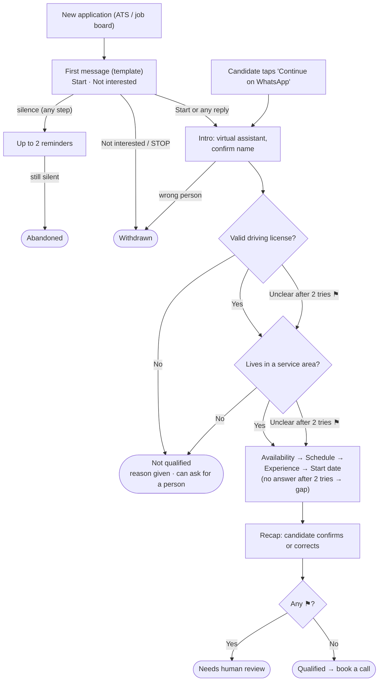

# Grupo Sazón · Candidate screening assistant: process design

*Phase 1 · Delivery drivers · Demo data (locations, service areas, FAQ) is synthetic.*

Today 13 recruiters phone about 1,000 applicants a week: 60% don't answer, and 80% of recruiter time goes to candidates who don't meet the basics. The assistant screens every applicant over messaging within minutes of applying. Candidates reply when it suits them; recruiters only handle qualified candidates and the few cases that need judgement.

## 1. Assumptions

- **Applications arrive automatically** from the ATS and job boards: name, phone, vacancy, WhatsApp opt-in.
- **Two ways in:** a "Continue on WhatsApp" link right after applying, or a first message from us.
- **Channels:** WhatsApp first (strictest rules), SMS with a chat link as fallback; voice notes are transcribed; voice calls follow the same flow. Demo: a mobile web chat.
- **Service areas** are sets of postal codes, defined per location.
- **Rules decide, people overrule:** fixed rules set the outcome from checked answers; recruiters can change it.

## 2. Conversation flow

**⚑ = review reason:** a required field (name, license, area) still unclear after 2 tries, a request for a person, or a knockout answer changed after hearing it disqualifies. **At any step:** FAQ questions are answered, silence triggers reminders, and STOP withdraws. 
**Status:** pending → invited → in progress → completed · abandoned (the stage is recorded; a late reply reopens it) · withdrawn (one closing message, then no more contact). **Outcome**, always with a reason: qualified · not qualified · needs human review.

## 3. Personality and tone (examples in the appendix)

"Sazi", Grupo Sazón's virtual assistant (persona and informal *tú* are client config).

- **Warm:** a friendly colleague from the hiring team, not a script.
- **Honest:** says it's virtual and never promises a job, pay or shifts.
- **Brief:** one question at a time, never re-asks.
- **Consistent:** same tone for everyone, simpler when a candidate struggles.
- **Focused:** one line for off-topic messages, then back to the screening.

| Do | Don't |
|---|---|
| One idea and one question; under 40 words; up to 3 bubbles, question last | Paragraphs, several questions, a question buried mid-turn |
| Short lines (greeting, content, question); at most one emoji; first name only at the start and the close | One dense block, formatting or lists (except the recap), the name in every message |
| Official terms of the country of work; gender-neutral: *¿Te interesa?* | Slang, imitating dialect, gendered words: *¿Estás interesado?* |
| Suggested replies for fixed options | Requiring a tap: free text always works |

## 4. Fields and validation

**Every field gets at most 2 tries** (the question, then a rephrase with options). After that, an unclear required field → ⚑, and any other field → a gap shown to the recruiter. Answers can come in any order and are never asked again.

| Field | What counts | Result |
|---|---|---|
| **Full name** (required) | From the application, confirmed in the intro; asks once for surname(s) if missing (two are common) | Missing → ⚑ |
| **Driver's license** ⛔ | Valid today for driving in the country of work | **Yes** · **No** (none, expired, in progress) → not qualified · **Unclear** (e.g. foreign) → ⚑ |
| **Service area** ⛔ | Home postal code or place, checked against all areas in the vacancy's country; place names are looked up, and the postal code asked if there's no single match | **Yes** → matching restaurant recorded · **No** (a postal code they've confirmed) → not qualified · **Unclear** → ⚑ |
| **Availability** | One or more of: full-time, part-time, weekends | "Only weekends" → weekends |
| **Schedule** | One or more of: morning, afternoon, evening, flexible | "I don't mind" → flexible |
| **Experience** | Years (0 is valid) + platforms (Glovo, Uber Eats, Rappi, DiDi Food, other); no minimum | "Never" → 0 years |
| **Start date** | A date in the restaurant's local time ("Monday" → date); no limits | "When I can" → asks for an approximate date |

⛔ = knockout. Also recorded: the talent-pool opt-in, and FAQ questions without an answer, which go to the recruiter.

## 5. Edge cases

| Situation | What the assistant does |
|---|---|
| **Silence** | Reminders at 4 h and 1 day (not started) or 2 h and 1 day (mid-chat, resuming where it stopped); *abandoned* after 3 days. Only 09:00–21:00 local; timings are config. |
| **Invalid or ambiguous answer** | Asks again once, with options |
| **Several messages at once** | Waits a moment, reads them together, keeps every answer |
| **Correction** ("it's 28905") | Updates and re-checks; the recap shows it |
| **Spanish ↔ English** | Follows the last full sentence; single words don't switch it |
| **Question about the job** | Answers from the FAQ only; otherwise "I'll check with the team" and the question goes to the recruiter |
| **Frustrated, or asks for a person** | Simpler messages and offers a person; ⚑ only if they ask or accept (after offering to finish the questions) |
| **Rude, or tries to steer the assistant** | One polite redirect; it can't change rules or outcomes; ends the chat if it continues |
| **Our side fails** | "Give me a moment", automatic retry, nothing lost; if it persists, the team is alerted and the chat resumes later |

## 6. Outcomes

Each outcome has a reason and a recruiter summary, and goes back to the ATS. Recruiters can override any outcome; the candidate is told.

| Outcome | Candidate hears | Recruiter sees |
|---|---|---|
| **Qualified** | Requirements met; books a call from the slots recruiters publish per location, or a recruiter follows up | "Ready" list: summary, gaps, matching restaurant, slot |
| **Not qualified** | The reason, how to come back, a person on request, the talent-pool offer | Closed; moves to review if a person is requested |
| **Needs human review** | A person will review it and get back to them | Review queue with the reason; one-click decision |

## 7. Measuring success

| Problem today | What we measure | Today |
|---|---|---|
| 60% don't answer calls | Response rate, completion rate, drop-off stage | ~40% reached |
| 80% of recruiter time on unqualified candidates | Recruiter time on qualified and review cases, review rate, overrides | 80% on unqualified |
| Candidates wait for a call | Time from application to outcome | Unknown |

## 8. Open questions for the client

1. **Applications:** which ATS and job boards, and can they push applications to us? *Assumed: yes.*
2. **Eligibility:** do you accept licenses from other countries? Are commuters from outside an area OK? *Today: a license from another country → a recruiter checks it; outside → not qualified.*
3. **Next step:** call or visit; who publishes slots; review turnaround? *Today: 10-min call, slots per location, 1 working day.*
4. **Legal sign-off:** automated knockouts with human review on request, notices, retention of transcripts and audio, and where data is processed (ES/MX). *Today: knockouts can be contested; audio deleted after transcription; the demo calls the model providers' APIs, outside the EU, with made-up data; real candidates' data would be processed in the EU on Vertex AI (or in Mexico if required).*
5. **Baseline:** current time-to-hire and hire rate of phone-screened candidates? *Today: unknown; needed to measure impact.*

## Appendix: example messages

| When | Spanish | English |
|---|---|---|
| First message, es-ES | 💬 Hola, {nombre} 👋 Soy Sazi, el asistente virtual de Grupo Sazón. ¿Te hago unas preguntas rápidas sobre tu solicitud? Son 3 minutos. `[Empezar]` `[No me interesa]` | 💬 Hi {name} 👋 I'm Sazi, Grupo Sazón's virtual assistant. Can I ask a few quick questions about your application? It takes 3 minutes. `[Start]` `[Not interested]` |
| Ambiguous answer | 💬 Perfecto. ¿Te apunto tarde y noche, o solo tarde? | 💬 Great. Afternoon and evening, or just afternoon? |
| Not qualified, es-ES | 💬 Gracias, {nombre}. Este puesto requiere carnet de conducir en vigor, así que por ahora no podemos seguir. 💬 Cuando lo tengas, vuelve a escribirnos. Si prefieres que lo revise una persona, dímelo. 💬 ¿Te avisamos si hay otros puestos en Grupo Sazón? `[Sí]` `[No]` | 💬 Thanks, {name}. This role requires a valid driving license, so we can't continue for now. 💬 Once you have one, write to us again. If you'd rather a person reviewed this, just tell me. 💬 Shall we tell you about other roles at Grupo Sazón? `[Yes]` `[No]` |
| Qualified, es-MX | 💬 ¡Listo, {nombre}! Tu perfil cumple con los requisitos. 💬 El siguiente paso es una llamada de 10 min con el equipo. ¿Cuándo te queda mejor? `[Mar 10:00]` `[Mar 17:00]` `[Otro horario]` | 💬 All set, {name}! Your profile meets the requirements. 💬 The next step is a 10-min call with the team. When works best for you? `[Tue 10:00]` `[Tue 17:00]` `[Another time]` |
